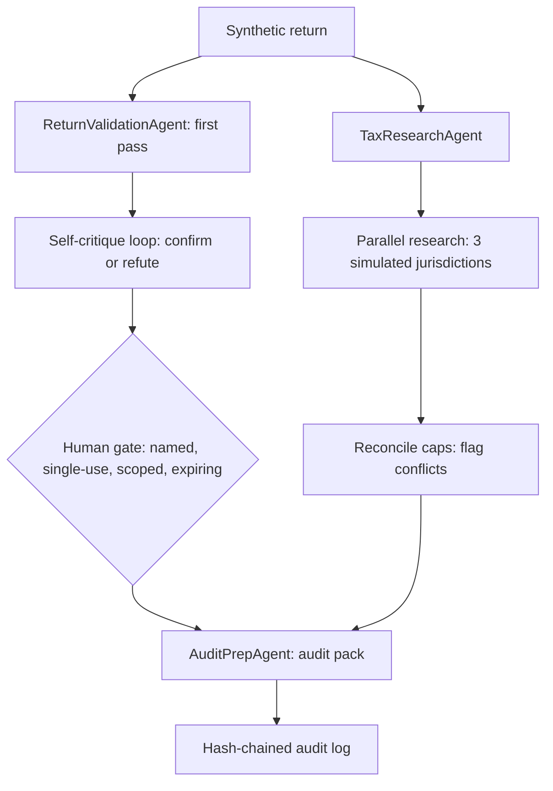

# Jagadish-tax-accounting-agents

**Recruiter summary.** A multi-agent tax-filing workflow demo built around
an orchestrator-worker pipeline: a research agent looks up synthetic tax
rules, a validation agent checks synthetic returns and then re-checks its
own findings, and an audit-preparation agent builds a redacted review pack.
Multi-jurisdiction research runs in parallel and is reconciled, and a human
approval gate stands in front of anything filing-facing. Proof: 58 tests
pass locally (system Python 3.12, pytest 9.1.1, standard library only).

**Disclaimer.** This project is independent and unaffiliated with any tax
authority, tax-software vendor, or accounting firm. All companies,
jurisdictions, rules, returns, and people named here are fictional or
synthetic. The fictional firm in the examples is Alderfen Ledger.

## HARD BOUNDARIES

- **Synthetic filings only.** Every return, rule, and jurisdiction in this
  repo is invented for demonstration.
- **No real tax advice for real persons.** Nothing here is advice about a
  real return, and nothing here may be used to prepare or file one.
- **This is a workflow demonstration, not a tax service.** It shows how
  research, validation, self-critique, reconciliation, human gating, and
  audit preparation can be orchestrated with agents. It is not a filing
  product.

## How it works

1. **Prevent — research.** `TaxResearchAgent` pulls synthetic rules for the
   return's jurisdiction, and parallel research covers three simulated
   jurisdictions (Northland, Eastvale, Southport) whose caps are then
   reconciled. Differing caps are flagged as a conflict, not silently
   resolved.
2. **Detect — validate and self-critique.** `ReturnValidationAgent`
   checks arithmetic, deduction and credit caps, completeness, and
   negative income. Its self-critique pass re-derives every finding and
   marks it confirmed or refuted; a lone high-ratio flag is refuted
   unless a confirmed error supports it.
3. **Gate — human approval.** Filing-facing work requires a named-person,
   single-use, scoped, expiring approval plus unambiguous consent plus
   confidence at or above 0.7. Bypass (no approval), reject ("no"),
   absent (empty consent), low-confidence, and self-contradicting consent
   ("yes, wait, no") all block the gate, and each case is tested.
4. **Recover — audit pack.** `AuditPrepAgent` builds a pack from confirmed
   findings only, with a PII-redacted summary. The pack is built even
   when the gate blocks, so the review record always exists.
5. **Governance and measurement.** Every stage is appended to a
   hash-chained audit log (tamper and dropped-entry cases are tested),
   and each run reports its own counts (see Demo numbers below).

## Architecture



## Demo numbers (from the actual run, 2026-11-03)

Running `PYTHONPATH=src python3 -m tax_accounting_agents.demo` prints:

```text
gate_passed=True
confirmed_findings=1
findings_total=1
jurisdictions_compared=3
reconciliation_conflict=True
pack_checklist_items=1
audit_entries=4
audit_chain_valid=True
redacted_summary=Filer DEMO-FILER-001 in Northland: income 80000.00, deductions 13000.00. Notes: Demo return; contact [EMAIL REDACTED], card [CARD REDACTED].
```

The demo return is synthetic: income 80000.00, deductions 13000.00
(over the synthetic Northland cap of 12000.00, hence the single confirmed
finding), credits 1000.00. Test suite: **58 passed** (see test files for
the per-area breakdown). These are regression-check numbers from a small
synthetic suite, not quality or accuracy claims about real tax work.

## How to run

```bash
python3 -m pytest tests/
PYTHONPATH=src python3 -m tax_accounting_agents.demo
```

Standard library only; no third-party dependencies. No network, no
credentials, no cloud resources.

## Guardrails and security controls

- **PII redaction checklist:** email addresses, Social Security numbers,
  phone numbers, and card numbers (13–19 digits with a Luhn check).
  The audit-pack summary is asserted PII-free in tests.
- **Confirmation gates:** bypass, reject, and absent-path tests, plus
  low-confidence and self-contradicting-consent tests.
- **Approvals:** named person, single use, exact scope, expiry.
- **Budgets:** negative cost inputs raise an error; never silently
  clamped.
- **Brand check:** blocklist stored as SHA-256 hashes only (no plain
  brand names in the repo); a test asserts the blocklist is non-empty.
- **Audit integrity:** hash-chained log; tamper and drop cases tested.

## Knowledge folder

Distilled notes and architecture docs, all original prose:

- [Tax workflow notes](knowledge/01-tax-workflow-notes.md)
- [Architecture](knowledge/02-architecture.md)
- [Guardrails and measurement](knowledge/03-guardrails-measurement.md)
- [Implementation guide](docs/implementation-guide.md)
- [ADR 001 — synthetic rulebook](docs/adr-001-synthetic-rulebook.md)

## Limitations and known failures

- Rules are synthetic and invented; they describe no real jurisdiction
  and must never be applied to a real return.
- There is no language-model integration, no real filing connection, and
  no handling of real tax forms, deadlines, or amended returns.
- CI is included in the scaffold but has never run on GitHub (see status
  table); do not treat this repo as CI-green.
- The 8-word overlap check against source material was not run, because
  this repo contains no copied source material — all prose is original
  and all data is synthetic. That check is recorded as not run, not
  passed.

## Built / Written-not-run / Planned

| Item | Status |
|---|---|
| Research, validation + self-critique, audit pack agents | Built, 58 tests passing locally |
| Multi-jurisdiction parallel research + reconciliation | Built, tested |
| Human approval gate, PII redaction, hash-chained audit, budget + brand checks | Built, tested |
| CI workflow file (`.github/workflows/ci.yml`) | Written, not run — CI NOT verified |
| Deployment, real filing integration, real rule source | Planned only — not built, not claimed |
| 8-word overlap check | Not run (no source material copied; original prose only) |
