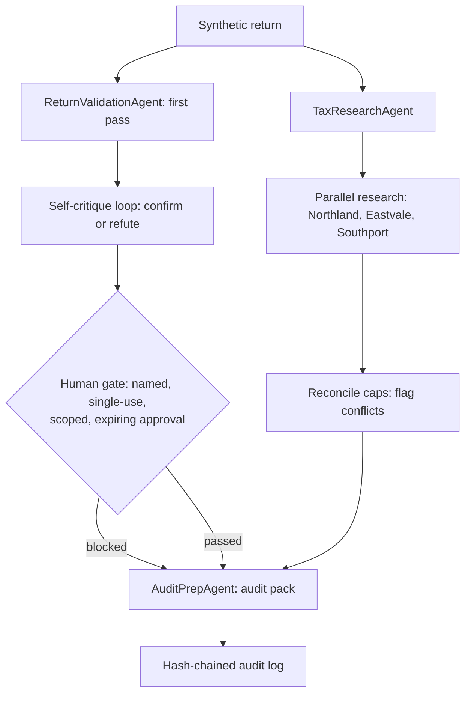

# Architecture

## Components

- **TaxResearchAgent** — reads the synthetic rulebook by topic and
  jurisdiction. No external calls, no real tax law.
- **ReturnValidationAgent** — arithmetic, cap, completeness, and ratio
  checks, followed by a self-critique pass that re-derives each finding.
- **AuditPrepAgent** — builds the audit pack from confirmed findings only,
  with a PII-redacted summary.
- **FilingPipeline (orchestrator)** — runs research, validation, critique,
  gate, and pack in order, and records every stage in the audit log.
- **Guards** — PII redaction (email, SSN, phone, card), approval gates,
  budget validation, brand-name hash check, hash-chained audit.
